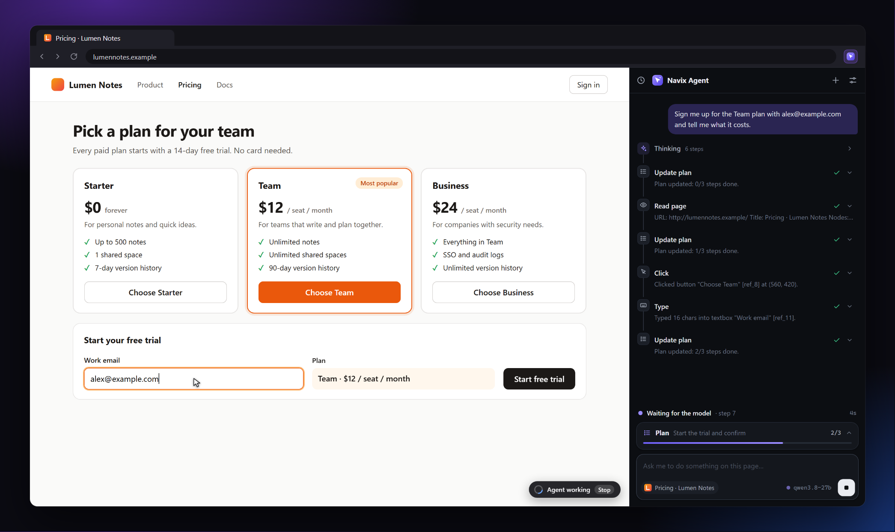
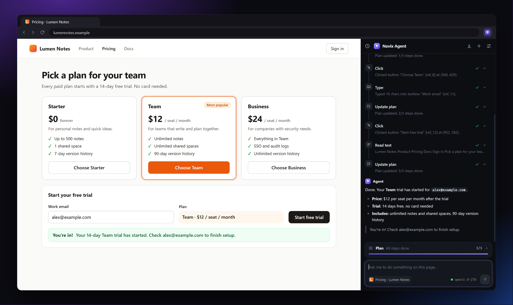
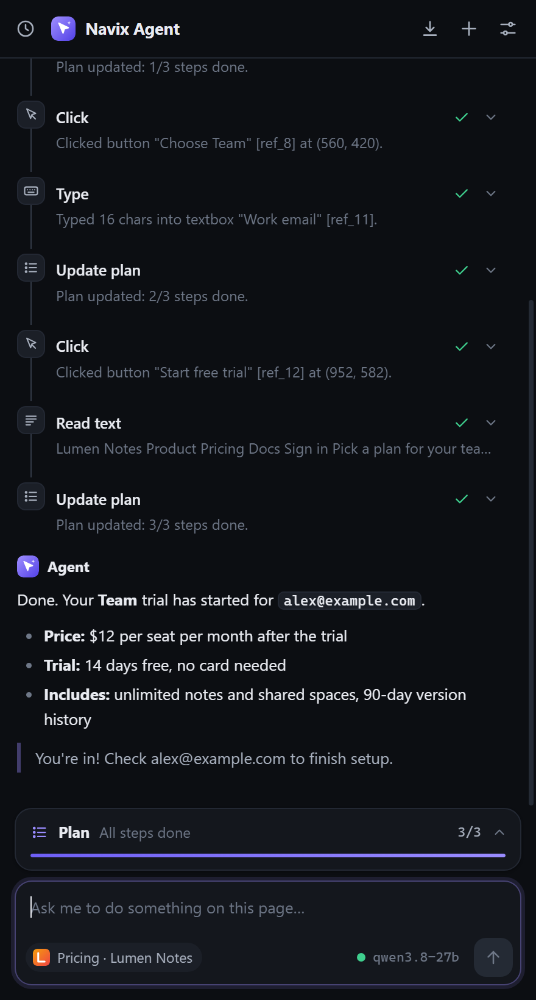
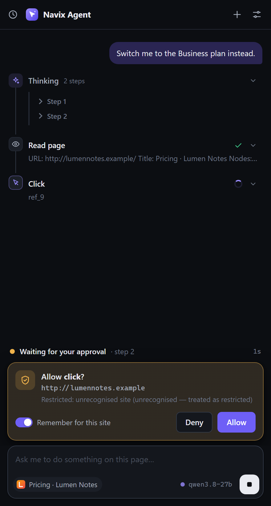
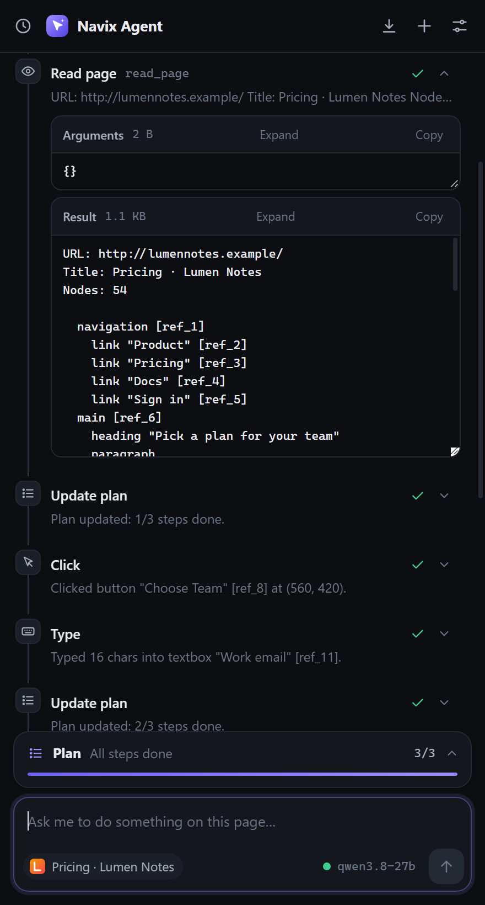
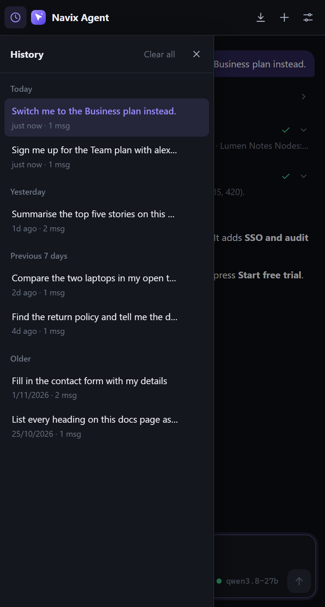
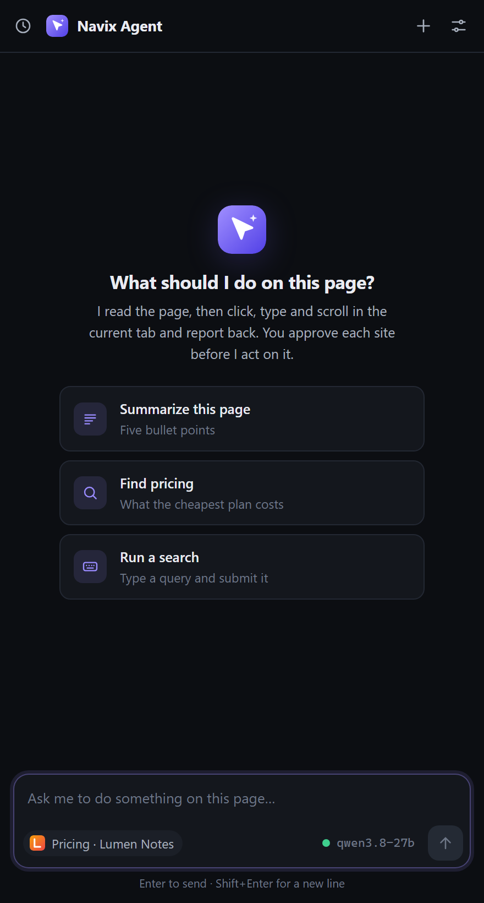
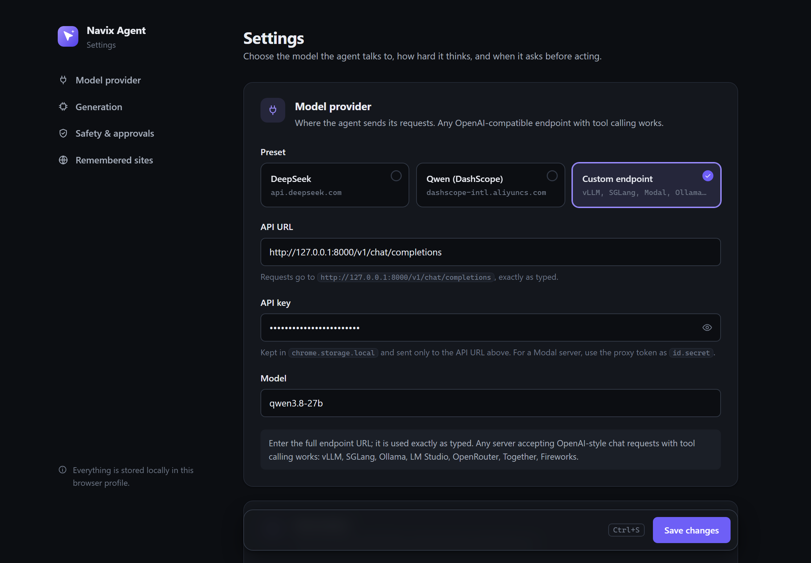

# Navix Agent

<p align="center">
  
</p>

A Manifest V3 Chrome/Edge side-panel agent that drives the browser the way the Claude
extension does, but talks to **any OpenAI-compatible endpoint** instead of a single
vendor. Ships with presets for DeepSeek and Qwen (DashScope compatible mode) and a
`custom` preset for vLLM / Ollama / llama.cpp / RunPod / Modal / OpenRouter.

## Screenshots

**Finished run.** The agent started the trial on the page and reports back with the price.

<p align="center">
  
</p>

The side panel follows your system theme, so these switch between dark and light with
your GitHub theme.

<table>
  <tr>
    <td align="center" width="33%">
      <picture>
        <source media="(prefers-color-scheme: light)" srcset="docs/screenshots/panel-answer-light.png">
        
      </picture>
      <br><b>Answers</b><br><sub>Tool timeline and a rendered Markdown reply</sub>
    </td>
    <td align="center" width="33%">
      <picture>
        <source media="(prefers-color-scheme: light)" srcset="docs/screenshots/panel-approval-light.png">
        
      </picture>
      <br><b>Approvals</b><br><sub>Asks before acting on a site, with the reason</sub>
    </td>
    <td align="center" width="33%">
      <picture>
        <source media="(prefers-color-scheme: light)" srcset="docs/screenshots/panel-tool-details-light.png">
        
      </picture>
      <br><b>Tool details</b><br><sub>Arguments and results for every step</sub>
    </td>
  </tr>
  <tr>
    <td align="center" width="33%">
      <picture>
        <source media="(prefers-color-scheme: light)" srcset="docs/screenshots/panel-history-light.png">
        
      </picture>
      <br><b>History</b><br><sub>Past chats, grouped by day</sub>
    </td>
    <td align="center" width="33%">
      <picture>
        <source media="(prefers-color-scheme: light)" srcset="docs/screenshots/panel-empty-light.png">
        
      </picture>
      <br><b>New chat</b><br><sub>Suggested prompts for the current tab</sub>
    </td>
    <td width="33%"></td>
  </tr>
</table>

**Settings.** Pick a provider preset or any OpenAI-compatible endpoint, then set the
model, reasoning effort and approval rules.

<picture>
  <source media="(prefers-color-scheme: light)" srcset="docs/screenshots/settings-light.png">
  
</picture>

<sub>The screenshots come from a scripted demo on a made-up site (`lumennotes.example`,
served locally) with a mock model, so they can be regenerated exactly. After changing
the UI, run `npm run build && npm run screenshots` (needs Edge).</sub>

## How it works

```
side panel  ──sendRequest──▶  service worker  ──SSE──▶  provider (OpenAI-compatible)
     ▲                              │
     └──────onEvent (stream)────────┘
                                    │
                                    ├─ chrome.debugger (CDP) ──▶ tab
                                    └─ content script ──▶ accessibility tree
```

- The **service worker** owns the agent loop: it calls the model, receives tool calls,
  executes them, and feeds results back until the model stops or `maxSteps` is hit.
- **CDP** (`chrome.debugger`) is attached lazily — only tools flagged `needsCdp` attach
  it, so a read-only run never shows the "debugging this browser" banner.
- The **content script** builds a compact accessibility tree with stable `ref_N`
  handles, so the model clicks by ref instead of guessing CSS selectors.
- A 0.5-minute `chrome.alarms` keepalive pokes the worker while a run is active so MV3
  does not suspend it mid-task.

## Setup

```bash
npm install
npm run build      # tsc --noEmit && vite build  ->  dist/
```

Then load `dist/` as an unpacked extension:

- **Edge**: `edge://extensions` → Developer mode → *Load unpacked* → pick `dist/`
- **Chrome**: `chrome://extensions` → Developer mode → *Load unpacked* → pick `dist/`

> Chrome 137+ removed the `--load-extension` command-line flag, so automated tests must
> use Edge (or Chrome for Testing). Manual unpacked loading still works in both.

Open the side panel, go to **Options**, pick a provider, paste an API key, save.

## Providers

| Preset | API URL | Default model |
| --- | --- | --- |
| DeepSeek | `https://api.deepseek.com/v1/chat/completions` | `deepseek-chat` |
| Qwen | `https://dashscope-intl.aliyuncs.com/compatible-mode/v1/chat/completions` | `qwen-plus` |
| Custom | `http://localhost:8000/v1/chat/completions` | *(you type it)* |

The API URL is the full endpoint and is used exactly as entered; nothing is appended
to it.

`deepseek-reasoner` and Qwen thinking models emit `reasoning_content`; the provider
layer surfaces that separately from the answer text so it never pollutes tool parsing.

### Long tasks and reasoning models

- **Reasoning effort** (options, default **Medium**) is sent to custom endpoints as
  `chat_template_kwargs.reasoning_effort`, which Qwen3.5-family chat templates on vLLM
  or SGLang read. Qwen3.8's template otherwise defaults to `xhigh`, which makes every
  step think at length. **Server default** sends nothing; hosted presets never get it.
- **Max tokens** includes thinking tokens. A reply cut off by the limit
  (`finish_reason: "length"`) ends the run with an error saying so, instead of
  sending the same request again. 16384 suits Qwen3.8 on the Modal server.
- **Old page snapshots are removed.** Every step sends the whole conversation, so each
  `read_page` or `get_page_text` (up to 20 000 characters) would otherwise stay in every
  later request. Once the older snapshots add up to 40 000 characters, all but the
  newest two (screenshots included) are replaced by a one-line stub naming the page.
  This is done in batches because rewriting an earlier message makes the server's
  prefix cache miss from that point on. The limits are constants at the top of
  `src/background/agent.ts`.
- The extra system prompt is appended to the built-in one, because Qwen3.5-family
  templates reject a second system message.

### Transient failures and cold starts

Serverless backends often fail while a container starts, for example Modal's
`503 {"error":"no upstreams available"}`. The agent waits these out instead of ending
the chat: statuses 408, 425, 429, 500, 502, 503, 504 and 529, plus failed connections,
are retried up to 12 times over about three minutes, with a live note in the side panel.
Delays double from 2 s to a 20 s cap, and `Retry-After` is honoured up to that cap. **Stop**
works during a wait. Other errors, such as a bad API key, fail immediately, and a turn
that has already streamed output is never retried, so nothing appears twice. To allow
longer cold starts, raise `MAX_MODEL_RETRIES` in `src/background/agent.ts`.

## Side panel

- **Activity timeline** — a run's thinking and tool calls form one connected timeline:
  each row has an icon, a readable name (`Read page`, `Click`, `Type`…) and a status
  (spinner, check or cross), joined by a rail so a long run reads as one unit.
- **Live status** — while a run is going, a strip above the composer says what the
  agent is doing (waiting for the model, thinking, running a tool, waiting for your
  approval or for a cold-starting server), with the step number and elapsed time.
- **Plan card** — `update_plan` shows as a one-line card above the composer with the
  current step, `done/total` and a progress bar; click it to see every step.
- **Approval card** — asks "Allow click?" with the site and why it needs approval, a
  Remember switch, and Deny/Allow. Nothing is focused for you, so Enter cannot approve
  by accident.
- **Composer** — shows which tab the agent will act on (favicon and title) and the
  model in use; the model chip opens the settings. Send is disabled while the box is
  empty.
- **Thinking blocks** — a run's reasoning is collected into a single collapsible
  **Thinking** row that reports how many steps it contains (`Thinking · 3 steps`), so a
  ten-step run reads as one row instead of ten stacked ones. Expanding it reveals one
  nested `<details>` per model turn (`Step 1`, `Step 2`, …), each holding only that
  step's thinking. Finished steps auto-collapse and the group collapses when the run
  ends; the latest step stays open so re-expanding the group shows the most recent
  reasoning.
- **Rendered answers** — assistant replies are rendered as Markdown (bold, italic,
  inline code, fenced blocks, bullet/numbered lists, headings, quotes, links) instead of
  showing literal `**` and `- `. Rendering is built from DOM nodes, never `innerHTML`, so
  a hostile page cannot inject markup through a tool result; only `http(s):` and
  `mailto:` links become clickable.
- **Tool rows** — the collapsed row shows the tool's readable name, its status and a
  one-line preview. Clicking expands it to show the raw tool name and two independent
  panes, **Arguments** and **Result**, each its own collapsible `<details>` with a
  payload-size badge, a **Copy** button and an **Expand**/**Collapse** toggle. Panes are
  capped at 200 px so a
  huge result cannot swallow the transcript; **Expand** lifts the cap and the `<pre>`
  also carries a native resize handle, so `read_page`'s accessibility tree and
  `get_page_text`'s page text can be read in full (up to 20 000 characters).
- **Right-aligned user turns** — your messages sit on the right in an accent bubble
  capped at 86 % width, while agent turns stay full width under an "Agent" label.
- **Copy buttons** — every fenced code block gets a header showing its language plus a
  **Copy** button, and every assistant answer gets a **Copy** button on hover that
  copies the raw Markdown. Both flash `Copied` on success and fall back to a hidden
  textarea + `execCommand` if the async clipboard API is unavailable.
- **History** (clock icon, top left) — a drawer listing the 50 most recent
  conversations, grouped into Today, Yesterday, Previous 7 days and Older, each with its
  title (taken from the first prompt), a relative timestamp and a message count. Click a
  row to restore that transcript — messages, thinking blocks, tool rows and code blocks
  all replay exactly as they were. The trash icon deletes one conversation, **Clear
  all** wipes the store. `Esc`, the close button or a click outside closes the drawer.
  History lives in `chrome.storage.local` under `conversations`.
- **New chat** (plus icon) — clears the transcript, plan, approval prompt, GIF button and
  the prompt box. If a run is in flight it is aborted first. The previous conversation
  is saved to history before the new one starts.
- **Conversation memory** — every prompt replays the earlier turns of the same chat to
  the model, so follow-ups like "and the second one?" work instead of the agent
  answering "I have no memory of previous conversations". The replay is rebuilt from
  the stored transcript: user prompts and assistant answers only, with tool cards and
  thinking dropped (an orphaned `tool` message without its matching `tool_calls` is
  rejected by strict OpenAI-compatible servers). Multi-step answers keep their
  paragraph breaks, and the replay is capped at the newest ~8 000 characters so a long
  chat cannot blow the context window. Opening a conversation from history restores
  its memory too.
- **Clean transcript** — a model that degenerates into repeating `---` separators
  would otherwise paint a wall of dividers, so runs of horizontal rules collapse to
  one and stray rules at the very start or end of a message are dropped. A step that
  streams no text (reasoning or a tool call only) no longer leaves a blank row.

For a self-hosted model, use the `custom` preset and set the API URL to your server's
full endpoint, e.g. `http://127.0.0.1:8000/v1/chat/completions` for vLLM or
`http://127.0.0.1:11434/v1/chat/completions` for Ollama.
The model must support OpenAI-style function calling.

## Settings page

Sections for the model provider, generation, safety and approvals, and remembered
sites, with a sidebar to jump between them (stacked on narrow windows). Provider presets
are cards; reasoning effort, approval mode, site safety and JS dialogs are segmented
controls that explain the selected option; on/off settings are switches; the API key
has a show/hide button. A save bar at the bottom flags unsaved changes, and `Ctrl+S`
saves. The underlying `<select>` and `<input>` elements keep their ids, so the stored
settings format is unchanged.

Both pages share `src/shared/theme.css` (colour, radius and type tokens, dark by
default and light with the system setting) and `src/shared/icons.ts` (line icons built
with `createElementNS`, the brand mark, and readable tool names).

## Tools exposed to the model

23 tools, each carrying `mutating` and `needsCdp` flags that drive the approval gate
and CDP attachment:

| Read-only | Mutating |
| --- | --- |
| `read_page`, `get_page_text`, `find` | `navigate`, `click`, `type`, `press_key` |
| `screenshot`, `read_console_messages` | `scroll`, `scroll_to`, `hover`, `drag` |
| `read_network_requests`, `tabs_list` | `tabs_create`, `tabs_switch`, `javascript_tool` |
| `read_dialogs` | `upload_file`, `set_viewport`, `set_zoom` |

`update_plan` is a bookkeeping tool: it takes no browser action, but it drives the
plan checklist rendered above the approval bar so long tasks stay legible.

`drag` accepts either two element refs or raw viewport coordinates and emits
intermediate `mouseMoved` events, so it works for both pointer-driven widgets
(sliders, canvas handles) and native HTML5 drag-and-drop.

## Approval modes

- **auto** — run every tool without asking.
- **ask** — consult remembered per-domain choices, then prompt. Non-`http(s)` pages
  (`file://`, `data:`) are always gated.

Approvals are remembered per origin, so a site you trust once stays trusted.

## Safety

Every mutating tool passes through a site classifier before it runs, and `agent/run`
refuses a blocked host up front so a run never starts and then silently does nothing.

| Tier | Examples | Behaviour |
| --- | --- | --- |
| `blocked` | banking, payments, tax, health records, password managers | never runs, in any mode |
| `restricted` | email, cloud consoles, source control, social, identity | prompts even in `auto` |
| `caution` | shopping, travel | prompts in `standard` |
| `safe` | docs, reference, search, `localhost` | runs unattended in `auto` |

The classifier **fails closed**: an unrecognised host is treated as `restricted`, so
`auto` mode never runs unattended on a site it has not seen before. The per-tool gate
re-reads the tab URL on every call, so mid-run navigation into a blocked site is caught
even if the run started somewhere safe.

## Visual feedback and recording

With **visual feedback** enabled, a cursor overlay animates to each click, type, hover
and drag target, and a badge shows the active step. Both overlays live in closed shadow
roots, so page CSS cannot restyle them and page scripts cannot read them.

Each run also records a GIF of the screenshots taken between tool calls. When a run
produces two or more frames, a download button appears in the side panel topbar.
Encoding happens in the service worker with `OffscreenCanvas` — no offscreen document
and no extra permission.

## Tests

```bash
npm run typecheck
npm run e2e          # core loop: fills and submits a real form
npm run e2e:drag     # pointer sliders + HTML5 drag-and-drop
npm run e2e:parity   # plan rendering, GIF export, safety gate
npm run e2e:ui       # reasoning blocks, markdown, tool output, copy buttons, memory, history, New chat, divider cleanup
npm run e2e:retry    # cold-start retries, Stop during a wait, errors that must not retry
npm run e2e:context  # one system message, reasoning effort, snapshot removal, max_tokens cut-offs
npm run e2e:all      # all six
```

All five require Edge; each starts a mock OpenAI-compatible SSE server, launches Edge
with the built extension, and drives the agent from the side panel.

The unit suites live in the session `domtest/` harness — 258 tests across DOM
extraction, provider streaming, the agent loop, the permission gate, the tool
registry, and the markdown renderer.

## Layout

```
src/background/   agent loop, provider client, CDP, DOM, tools, safety, gif, visual
src/sidepanel/    chat UI, plan checklist, GIF export
src/options/      provider, API key, safety and feedback settings
src/shared/       types, storage, messaging, provider presets
public/           manifest, content scripts, icons
tests/            real-browser end-to-end harnesses
scripts/          screenshot generator for this README (demo site, scripted model)
docs/screenshots/ images used in this README
```
